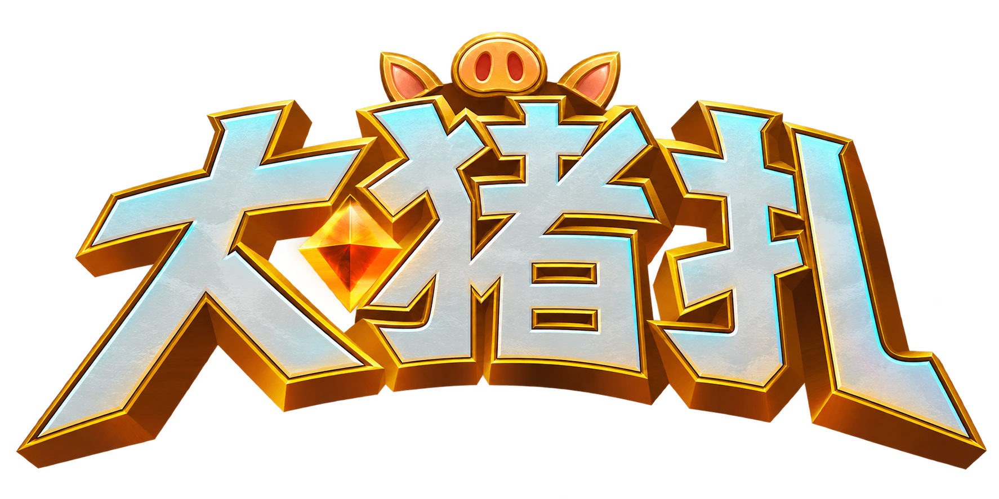
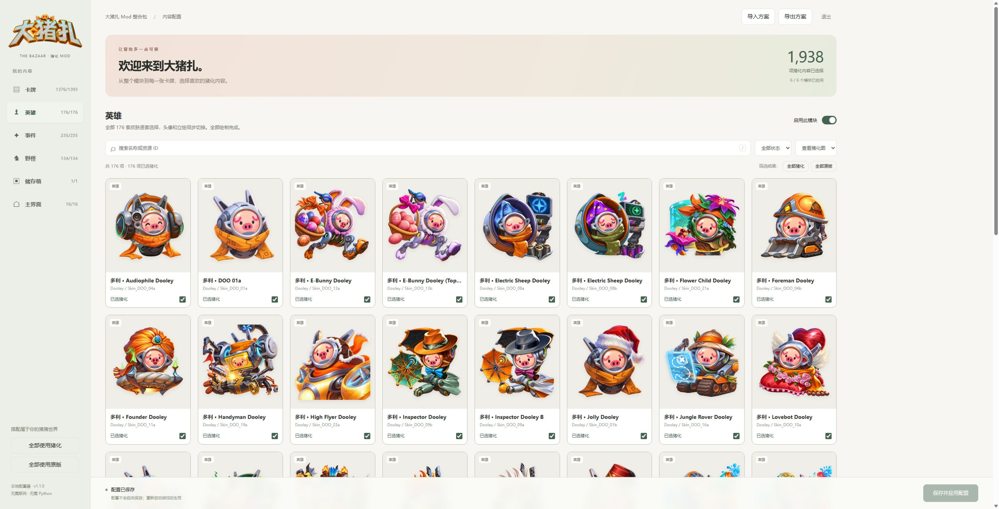

给《The Bazaar / 大巴扎》换上一套可爱的猪猪外观。

# 大猪扎

大猪扎是《The Bazaar》的非官方外观 Mod，包含卡牌、英雄皮肤、事件、野怪、储存箱和主界面猪化，以及可以细选到单张卡牌、单套皮肤的本地配置器。

当前版本为 **v1.1.0-preview.2-lossless**。已完成当前客户端资源中的 **176 / 176 套英雄皮肤，352 张头像与立绘**，每套可独立选择猪化或原版。176 是当前客户端资源清单数量，不代表均已公开发售或已解锁。

## 内容

| 模块 | 本版内容 |
| --- | --- |
| 卡牌 | 1,393 张可查看，1,376 张正式卡可单独选择；17 张概念卡停用 |
| 英雄 | 176 套全部完成，352 张图；每套独立选择，头像与立绘一起切换 |
| 事件 | 235 项 |
| 野怪 | 134 项，配套图层成组切换 |
| 储存箱 | 1 项 |
| 主界面 | 16 组，23 个图层，保留城市构图与动画部件关系 |

卡牌以原始图片为基础猪化，保留原背景与文字。附魔沿用游戏原来的材质、遮罩、颜色和特效，仅替换主贴图。Mod 不提供皮肤解锁功能。

## 下载

**2026-10-25 安装修复已发布**：若选择游戏文件夹后出现 `Install.ps1:16` / `ConvertFrom-Json` 红字，请下载 [InstallerFix 小补丁](https://github.com/wjxkdym/dazhuzha/releases/download/v1.1.0-preview.2-lossless/Dazhuzha-v1.1.0-preview.2-lossless-InstallerFix.zip)，用其中的 `Install.ps1` 覆盖原解压目录中的同名文件，再运行安装。无需重下素材。新下载的 Core 包已包含修复；百度网盘同步提供补丁。

[百度网盘下载](https://pan.baidu.com/s/1mrMRBw9EiSt3kIHC6y7zKw?pwd=q79x) · 提取码 **q79x** · [完整清单与安装说明](docs/DOWNLOADS.md)

[GitHub Releases 下载](https://github.com/wjxkdym/dazhuzha/releases/tag/v1.1.0-preview.2-lossless)。完整包约 3.63 GB，必须下载 Core 和 3 个 Assets ZIP。

## 安装

支持当前已验证编译的 Windows 版客户端与 **BepInEx 5** 环境。本地构建依赖为 BepInEx 5.4.23.5、Unity 6000.3.11f1 的 Mono 程序集。客户端资源更新后需要重新核对兼容性。

1. 按[下载渠道与安装包清单](docs/DOWNLOADS.md)，从百度网盘或GitHub Releases 下载同版本 `Core.zip` 和**全部** `Assets-XX.zip`。
2. 将这些 ZIP 解压到同一个目录，合并同名的 `Dazhuzha-v1.1.0-preview.2-lossless` 文件夹。
3. 游戏应已安装匹配的 BepInEx 5。退出游戏和大猪扎配置器。
4. 双击 `安装大猪扎.cmd`，选择包含 `TheBazaar.exe` 的游戏目录。
5. 双击 `打开大猪扎配置器.cmd`，选择内容后点击“保存并应用配置”，重新启动游戏。

不用安装 Python 或 Node 来使用配置器。浏览器仅连接本机；关闭网页后托盘程序仍在运行，可用页面或托盘的“退出”关闭。

源码下载包不包含完整美术素材，不能代替 Releases 安装包。缺少任一素材 ZIP 时安装器会报告缺失文件。

## 配置

支持中文名、英文名与资源 ID 搜索，卡牌尺寸筛选，原图与猪化预览，单项开关、模块开关，以及方案导入导出。关闭模块会保留单项选择。

配置位于 `BepInEx/config/PigModSuite/settings.json`。升级保留该文件；每次保存会备份原配置。旧版插件 ID 和配置路径继续使用，方便原用户升级。

## 验证状态

已完成源码编译、逐项配置与 API 测试、皮肤映射和素材文件校验，英雄图片已逐张检查。作者已确认进行了实际游戏内测试。具体检查记录见[验证记录](docs/VERIFICATION.md)。

- [使用与卸载](docs/USAGE.md)
- [构建与测试](docs/DEVELOPMENT.md)
- [发布步骤](docs/RELEASING.md)
- [本版发布说明](RELEASE_NOTES.md)
- [素材与第三方说明](THIRD_PARTY_NOTICES.md)

项目 C#、脚本与界面代码采用 [MIT 许可](LICENSE)。该许可不覆盖游戏原始素材、派生美术、Logo 与第三方商标。美术包含 AI 辅助重绘；本项目与游戏官方无隶属关系。
